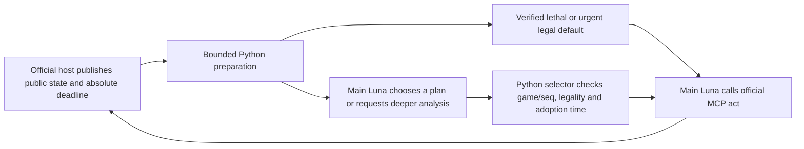

# Decision architecture

The development session reads guides, writes code and analyzes experiments. It is
not a participant in evaluation games. The course launcher starts one independent
gpt-6-luna main session per skill seat, medium effort. No model is called by Python.

The public state supplies legal templates and current card stats. Full public
history adds hero-attack availability, shown cards and tentative opponent-pressure
counts. The policy never receives private hands, library order, random seed,
opponent strategy name or opponent path. Research game IDs are opaque random IDs.
Opponent identity/seed appears only in the outside scheduler's result mapping.

base_policy ranks tempo plays. secret_policy adds the fixed deck's contextual
Secret, Beast, weapon, Tracking and curve hypotheses, computes distinct candidate
plans and risk summaries, and presents next-turn burn assumptions. C5's default
is also executable without model authority. A0 preserves the earlier same-deck
generic baseline; the final C5-off arm isolates the model-authority switch using
otherwise identical files and preprocessing.

The authority switch constrains the helper's returned action; it cannot revoke
Luna's MCP tool. The actual C4 off arm still changed 14 of 1,831 default actions,
including 13 mismatches after a selection returned the validated default. Report
this as an imperfect intent-to-treat configuration ablation, not a clean causal
isolation of all model strategy. C5 off also deviated in four of 1,035 actions,
including three changed validated actions. The smaller frequency does not remove
this limitation or establish a statistically reliable compliance improvement.

tactical_model projects a conservative public-effect subset; lethal_planner uses a
bounded beam and returns proof/unknown/unsupported. Random Companion analysis
enumerates three entourage branches; unsearched continuations remain unproved.
Juggler summon randomness and unknown enemy Secrets do not become fabricated
deterministic worlds. Two-turn burn summaries are conditional resource calculations,
not a forecast that the board survives or a calibrated win probability.

The script parent enforces a wall-clock worker timeout. Its selector checks current
game/seq, concrete legal action, duplicates, and the fixed adoption deadline. It
records proposal ID/reason, acceptance or fallback and disagreement with default.
Only Luna owns the MCP action tool. Prompt compliance is therefore an empirical
property: audit compares actual act calls with prepared defaults and validated
selections rather than trusting a model's explanation. A legal action bypassing
the intended validator remains a workflow defect even if the host accepts it.

The official skill contract does not expose a script submission connection inside
the authorized folder. Consequently no local helper can force a deadline submission
when Luna stalls. Tool cancellation, suggestion rejection and generation cancellation
are three different capabilities; only the first two are implemented, with the
second conditional on the main model invoking the selector. Initial model startup
and deck submission have the same limitation. See CONTRACT.md and actual model
audits for the measured boundary. The ZIP is a research artifact, not a claim of
unconditional 180-second compliance.
